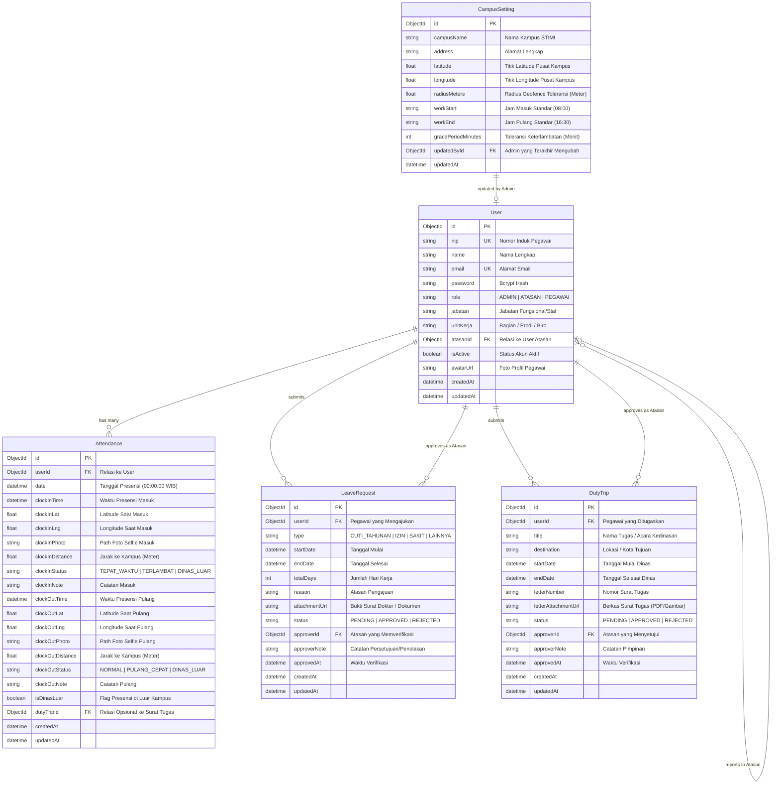

# Entity Relationship Diagram (ERD) — PRESENSISTIMI

Dokumen ini mendefinisikan model data relasional-dokumen untuk aplikasi **PRESENSISTIMI** menggunakan **MongoDB** dan **Prisma ORM**.

---

## 1. Visual Entity Relationship (Mermaid Diagram)



---

## 2. Skema Prisma untuk MongoDB (`schema.prisma`)

Berikut adalah skema referensi yang akan digunakan pada Prisma ORM:

```prisma
datasource db {
  provider = "mongodb"
  url      = env("DATABASE_URL")
}

generator client {
  provider = "prisma-client-js"
}

enum Role {
  ADMIN
  ATASAN
  PEGAWAI
}

enum AttendanceStatus {
  TEPAT_WAKTU
  TERLAMBAT
  DINAS_LUAR
}

enum ClockOutStatus {
  NORMAL
  PULANG_CEPAT
  DINAS_LUAR
}

enum LeaveType {
  CUTI_TAHUNAN
  IZIN
  SAKIT
  CUTI_MELAHIRKAN
  LAINNYA
}

enum RequestStatus {
  PENDING
  APPROVED
  REJECTED
}

model User {
  id             String         @id @default(auto()) @map("_id") @db.ObjectId
  nip            String         @unique
  name           String
  email          String         @unique
  password       String
  role           Role           @default(PEGAWAI)
  jabatan        String
  unitKerja      String
  atasanId       String?        @db.ObjectId
  atasan         User?          @relation("Hierarchy", fields: [atasanId], references: [id], onDelete: NoAction, onUpdate: NoAction)
  bawahan        User[]         @relation("Hierarchy")
  isActive       Boolean        @default(true)
  avatarUrl      String?
  createdAt      DateTime       @default(now())
  updatedAt      DateTime       @updatedAt

  attendances    Attendance[]
  leaveRequests  LeaveRequest[] @relation("UserLeaves")
  approvedLeaves LeaveRequest[] @relation("ApproverLeaves")
  dutyTrips      DutyTrip[]     @relation("UserDutyTrips")
  approvedTrips  DutyTrip[]     @relation("ApproverDutyTrips")
  campusSettings CampusSetting[]

  @@map("users")
}

model Attendance {
  id               String            @id @default(auto()) @map("_id") @db.ObjectId
  userId           String            @db.ObjectId
  user             User              @relation(fields: [userId], references: [id], onDelete: Cascade)
  date             DateTime          // Disimpan pada 00:00:00 WIB untuk pencarian harian
  
  // Masuk (Clock-in)
  clockInTime      DateTime?
  clockInLat       Float?
  clockInLng       Float?
  clockInPhoto     String?
  clockInDistance  Float?            // Jarak meter ke kampus
  clockInStatus    AttendanceStatus?
  clockInNote      String?

  // Pulang (Clock-out)
  clockOutTime     DateTime?
  clockOutLat      Float?
  clockOutLng      Float?
  clockOutPhoto    String?
  clockOutDistance Float?
  clockOutStatus   ClockOutStatus?
  clockOutNote     String?

  isDinasLuar      Boolean           @default(false)
  dutyTripId       String?           @db.ObjectId
  dutyTrip         DutyTrip?         @relation(fields: [dutyTripId], references: [id])

  createdAt        DateTime          @default(now())
  updatedAt        DateTime          @updatedAt

  @@unique([userId, date])
  @@index([date])
  @@index([userId])
  @@map("attendances")
}

model LeaveRequest {
  id           String        @id @default(auto()) @map("_id") @db.ObjectId
  userId       String        @db.ObjectId
  user         User          @relation("UserLeaves", fields: [userId], references: [id], onDelete: Cascade)
  type         LeaveType
  startDate    DateTime
  endDate      DateTime
  totalDays    Int
  reason       String
  attachmentUrl String?
  status       RequestStatus @default(PENDING)
  
  approverId   String?       @db.ObjectId
  approver     User?         @relation("ApproverLeaves", fields: [approverId], references: [id])
  approverNote String?
  approvedAt   DateTime?

  createdAt    DateTime      @default(now())
  updatedAt    DateTime      @updatedAt

  @@index([userId])
  @@index([status])
  @@map("leave_requests")
}

model DutyTrip {
  id                  String        @id @default(auto()) @map("_id") @db.ObjectId
  userId              String        @db.ObjectId
  user                User          @relation("UserDutyTrips", fields: [userId], references: [id], onDelete: Cascade)
  title               String
  destination         String
  startDate           DateTime
  endDate             DateTime
  letterNumber        String?
  letterAttachmentUrl String?
  status              RequestStatus @default(PENDING)

  approverId          String?       @db.ObjectId
  approver            User?         @relation("ApproverDutyTrips", fields: [approverId], references: [id])
  approverNote        String?
  approvedAt          DateTime?

  attendances         Attendance[]

  createdAt           DateTime      @default(now())
  updatedAt           DateTime      @updatedAt

  @@index([userId])
  @@index([status])
  @@map("duty_trips")
}

model CampusSetting {
  id                 String   @id @default(auto()) @map("_id") @db.ObjectId
  campusName         String   @default("STIMI")
  address            String   @default("Kampus STIMI")
  latitude           Float    @default(-3.3186)  // Default koordinat referensi
  longitude          Float    @default(114.5944) // Dapat diubah oleh Admin di dashboard
  radiusMeters       Float    @default(100.0)   // Radius toleransi geofence dalam meter
  workStart          String   @default("08:00")  // Format HH:mm
  workEnd            String   @default("16:30")  // Format HH:mm
  gracePeriodMinutes Int      @default(15)       // Menit toleransi keterlambatan
  
  updatedById        String?  @db.ObjectId
  updatedBy          User?    @relation(fields: [updatedById], references: [id])
  updatedAt          DateTime @updatedAt

  @@map("campus_settings")
}
```

---

## 3. Strategi Indexing & Performa MongoDB

1. **Compound Index `[userId, date]` pada `Attendance`**:
   - Memastikan seorang pegawai hanya memiliki 1 catatan induk presensi per hari kerja.
   - Mengoptimalkan pencarian status kehadiran pegawai hari ini menjadi $O(1)$.
2. **Single Field Index `[date]` pada `Attendance`**:
   - Mengakselerasi pembuatan laporan rekap harian atau rentang tanggal bulanan untuk seluruh staf kampus.
3. **Index `[userId]` dan `[status]` pada `LeaveRequest` & `DutyTrip`**:
   - Mempercepat query daftar tugas yang belum diverifikasi (*pending review*) di dashboard Atasan.
